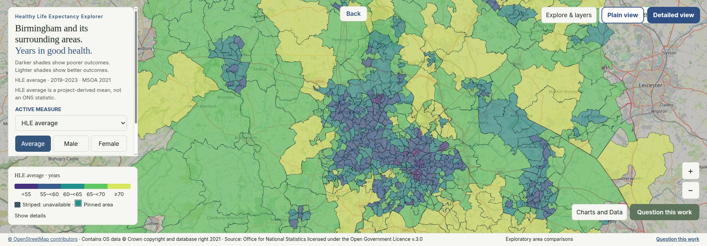
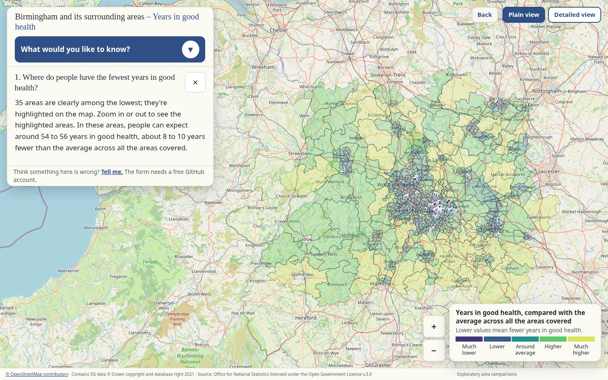

# The Ethics of a Birmingham Healthy Life



**On this page:**


[The plan](#1-the-plan-and-the-idea) · [Start with the site](#2-start-with-the-site) · [Signal Box results](#5-results-of-applying-signal-box) · [Findings](#7-headline-findings-from-notebooks-0709) · [Notebooks](#10-notebooks-and-how-to-run-them) · [Testing](#12-testing-and-evaluation) · [Known issues](#14-known-issues-and-bugs) · [Criteria map](#16-learning-outcome-criteria-map) · [Reflection](#17-reflection)

## Purpose

The Code Institute's Unit 3 assessment is an exercise in the ethical handling of data. I had just built, for Unit 2, a large and complex investigation into healthy life expectancy in Birmingham and its surrounding areas, drawing on data about ethnicity, sex, income, crime and other features of local life. It seemed an ideal project against which to apply an ethics-first lens.

I began by looking back at the work I'd done on the Code Institute's ethics module in their LMS. To help my fellow students with that module, I built a web page called [Ethical Considerations in AI](https://tidyweb.github.io/ethical-considerations-in-ai/). Inside that, I built a utility I called [Signal Box](https://tidyweb.github.io/ethical-considerations-in-ai/#screening-tool), which was a way to check ethical considerations using 27 yes or no questions about who a data project could harm and how. Each question has a lamp: orange for a concern, yellow once the concern has been investigated and recorded, grey where no concern was raised. Signal Box is my own study material, not official Code Institute material.

*The Ethics of a Birmingham Healthy Life* is an ethical revision of my Unit 2 project. I revisit the Birmingham Healthy Life area-level healthy life expectancy analysis because it was rich in ethical dilemmas.  I here examine how its methods and claims should be understood, and add checks on proxy overlap, model error, ranking uncertainty and variation hidden by aggregation. It describes patterns across 660 Middle Layer Super Output Areas (MSOAs); NB: It does not explain any individual's health or establish causes.

I want what's in this project to be available to people who work with data and to people who don't. So the dashboard has two views. It opens in the **Plain view**: a short list of plain questions, such as where people have the fewest years in good health, each answered in a sentence or two without jargon. The **Detailed view**, one click away, keeps the full technical dashboard, with every measure, the uncertainty ranges and the data tables.

Running Signal Box over real work also showed up its own weak spots. My pop-ups never said how to clear an orange lamp, and nothing defined what earned a yellow one. I fixed both on 19 October 2026, so this project is also partly a test of whether the tool does the job I intended it to do.

## 1. The plan and the idea

Given the huge amount of work I had put into the Unit 2 assessment, and the ethical issues the topic presented and which I handled from a privacy perspective only, I felt that a deeper look at the project from an ethics first perspective was in order.   I had the source material, but I had no plan.  I realised that my work building a web guide to ethics could serve as a perfect starting point from which to approach this new task. I engaged Claude as my architectural assistant and used a 'Grill Me' skill to examine and refine not only my objective, but also the wealth of considerations present in the original datasets of Unit 2.  My plan evolved and changed as I went along and the project board records some of this.
These three links below show where the foundation for this idea came from and how it got built.

- **[Project board](https://github.com/users/TidyWeb/projects/2):** every step of the project, with what I found and what I decided along the way.
- **[The original project (Unit 2)](https://tidyweb.github.io/Birmingham-Healthy-Life/):** the work I'm taking a second look at. It's left exactly as it was submitted.
- **[Ethical Considerations in AI](https://tidyweb.github.io/ethical-considerations-in-ai/):** my guide to the Code Institute ethics lesson, and where Signal Box lives.

### The plan in phases

Each phase's cards are on the project board. Work added later carries a letter after the card it belongs with, such as 17A for the Plain view.

| Phase | What it covered | Board cards |
|---|---|---|
| 0. Set-up | Permission to reuse Unit 2, copying its repos, checking everything still ran | 01–05 |
| 1. The ethics screen | Signal Box answers as data, the introduction, the method, results at a glance | 06–11 |
| 2. New analysis | Uncertainty and ranking (Notebook 08); proxies, fairness and crime (Notebook 07) | 12–13 |
| 3. Write-up | A chapter for each Unit 2 stage, the new findings, carried-over material | 14–16 |
| 4. Dashboard and BI | Uncertainty in the dashboard, the Plain view, Tableau's role | 17–18 |
| 5. Governance and lifecycle | Law and governance, updates and corrections, a public question route, the language audit, Notebook 09 | 19–23 |
| 6. Testing and evaluation | User testing, the Signal Box re-test, accessibility | 24–26 |
| 7. README, reflection, submission | Reflection, this README, a clean-clone check, submission | 27–30 |

How the project would be maintained, updated, corrected and retired after submission is in [section 15](#15-lifecycle) and on the [Lifecycle](https://tidyweb.github.io/Birmingham-Healthy-Life-Second-Look/story/lifecycle.html) page.

## 2. Start with the site

The website has the full story, and is the more comprehensive readme, containing both the notebooks and the dashboard. On the home page, choose **The story** and begin with *Why a second look*.

- **[Dashboard](https://tidyweb.github.io/Birmingham-Healthy-Life-Second-Look/dashboard/):** opens in the Plain view, with plain questions and plain answers. The Detailed view is one click away.

### At a glance

My checks describe area-level patterns and do not establish causes:

- **Ranking uncertainty:** 35 of the 66 MSOAs with the lowest published HLE had at least a 95% simulated probability of remaining in the bottom tenth; the other 31 did not meet that threshold. A published rank is not certain.
- **Model error by deprivation:** the model ran low by 0.31 years in the least-deprived third of MSOAs and high by 0.46 years in the most-deprived third; both 95% bootstrap intervals excluded zero. These are area-level prediction errors.
- **Aggregation:** 30.3% of the variance across 3,205 Lower Layer Super Output Area (LSOA) fuel-poverty percentages was within MSOAs, with each LSOA contributing equally. This is a descriptive decomposition, not a significance test.

## ▶ [Start here: open the site](https://tidyweb.github.io/Birmingham-Healthy-Life-Second-Look/)

## 3. The stance

**The aim is the truth about healthy life expectancy, told plainly. Ethical care means not causing avoidable harm and not claiming more than the evidence shows. It does not mean avoiding uncomfortable findings.**

## 4. Audience

I wrote this for people who know Birmingham and its neighbouring West Midlands areas, including residents and people who work with local data or services. Some of them work with data and some don't, so each gets a different way in.

**If you don't work with data**, start with the [dashboard](https://tidyweb.github.io/Birmingham-Healthy-Life-Second-Look/dashboard/). It opens in the Plain view. Pick a question from "What would you like to know?" and the answer comes back in a sentence or two, with the map showing what it's talking about. Click any area and you get one plain sentence about it. Uncertainty is described the way a weather forecast would describe it: an area is "clearly", "probably" or "possibly" among the lowest. On the story pages, every chapter opens with an "In short" box.

**If you do**, one click on Detailed view gets you the full technical dashboard: every measure, the rank ranges, the data tables and the CSV download. The story chapters carry the reasoning. The nine notebooks carry the calculations, and you can re-run them.

The Plain view leaves the model's predictions out on purpose. A predicted figure next to a real one reads like a verdict on a place: it's doing worse than it should. The model can't carry that weight, and Signal Box flagged the risk (Q14, outputs treated as proof). The predictions stay in the notebooks, with their limits stated, for readers who can weigh them.

Five testers tried the site and the Detailed view on 20 October 2026 and found every task clear, one of those was me though, so I exclude myself from the testing record (section 12).

## 5. Results of applying Signal Box

My first application of Signal Box recorded **17 concerns** and **10 with no concern raised**. In Unit 3, after the say-it-out-loud re-test, **14 are investigated and recorded**, **3 are settled by executive decision (Q4, Q18 and Q21)**, and **10 remain with no concern raised**. A recorded response does not mean the risk has gone; no concern raised does not prove safety. Signal Box is a screening aid, not a legal assessment.

Before I turn a lamp yellow, I must be able to say what could go wrong, who it would happen to, what deals with it, and who is responsible. If I cannot say that in a sentence or two, the lamp stays orange. Applying this sharper test moved Q4 back to orange; that is a finding of testing the tool on my own work.

I looked at each of the three and decided to go ahead anyway:

- **Q4 — Benefit to me, cost to others:** I gain assessment and portfolio evidence while people in named areas could bear stigma. I accept that as the cost of trying to get to the truth about these differences, and I keep it down with broad labels, honest uncertainty and a policy on naming places.
- **Q18 — Affected people left out of design and testing:** The study covers 660 areas and several million people. There's no practical way to involve them all, and publishing area-level statistics doesn't need their permission.
- **Q21 — Tested only in a demo, not real use:** This is a course project, built to be assessed, not for anyone to rely on, so it won't be tested in real use.

The guide develops the Code Institute LMS lesson “Ethical considerations in AI” with independent research, including UNESCO’s AI ethics Recommendation, the OECD AI Principles, NIST’s AI Risk Management Framework, UK GDPR changes under the Data (Use and Access) Act 2025, ICO guidance and the EU AI Act. It is independent study material, not official Code Institute material; its legal checks are dated 14 October 2026.


The board, all 15 verbatim say-it-out-loud statements and the question-by-question evidence are in [What changed](https://tidyweb.github.io/Birmingham-Healthy-Life-Second-Look/story/what-changed.html).

## 6. Questions and hypothesis

The carried-over analysis asks how healthy life expectancy varies across Birmingham and nearby areas, whether large differences between neighbouring areas exceed estimate noise, which area measures move with HLE, how well selected measures describe HLE, and what distinguishes the sharpest neighbouring gaps. The original five questions and evidence are set out in [Why a second look](https://tidyweb.github.io/Birmingham-Healthy-Life-Second-Look/story/s1-why-a-second-look.html), [The method](https://tidyweb.github.io/Birmingham-Healthy-Life-Second-Look/story/s2-the-method.html) and [Results at a glance](https://tidyweb.github.io/Birmingham-Healthy-Life-Second-Look/story/s3-results-at-a-glance.html).

The hypothesis test in Notebook 04 is:

- **H₀:** neighbouring MSOAs do not differ beyond the noise in their HLE estimates.
- **H₁:** neighbouring MSOAs differ by more than that noise can explain.

Across 1,885 neighbouring pairs, 1,316 (69.8%) exceeded the 1.96 noise threshold; the simulation expected about 5% under noise alone. I reject H₀ for this test. That does not identify causes.

The new ethical questions were whether model features overlap with broad ethnic composition or deprivation, whether prediction errors differ across area groups, how certain the published low rankings are, and how much variation is hidden when LSOA data are averaged to MSOAs. Notebooks 07–09 examine these questions descriptively; none makes a claim about an individual.

## 7. Headline findings from Notebooks 07–09

- **Notebook 07 — proxy and fairness audit:** across 654 MSOAs, the seven model features predicted broad area ethnic-composition shares with cross-validated R² values from 0.277 (Other White) to 0.743 (White British); the other group results are in the notebook. This is evidence of area-level proxy overlap, not a way to infer a person's ethnicity. The model ran low by 0.31 years in the least-deprived third and high by 0.46 years in the most-deprived third; both 95% bootstrap intervals excluded zero. Removing the crime feature changed RMSE by about 0.01 years and R² by about −0.0013.
- **Notebook 08 — uncertainty and ranking:** 10,000 simulations gave 35 of the 66 areas with the lowest published HLE a probability of at least 95% of remaining in the bottom tenth. The other 31 did not meet that threshold. The median 90% rank-interval width was 65 places across all 660 areas.
- **Notebook 09 — aggregation:** of the variance across 3,205 LSOA fuel-poverty percentages, 30.3% was within MSOAs and 69.7% was between LSOA-count-weighted MSOA means. Each LSOA contributes equally to this decomposition. A separate range-versus-range rule flags 255 of 660 MSOAs (38.6%) as “mixed”; it is a descriptive comparison, not a significance test. **Methods note:** the earlier rule compared an internal range with a difference of means, so it was not like-for-like; it flagged 581/660 areas.

The findings and limits are discussed in [How certain are the rankings?](https://tidyweb.github.io/Birmingham-Healthy-Life-Second-Look/story/how-certain-are-the-rankings.html), [Proxies, fairness and crime](https://tidyweb.github.io/Birmingham-Healthy-Life-Second-Look/story/proxies-fairness-and-crime.html) and [What aggregation hides](https://tidyweb.github.io/Birmingham-Healthy-Life-Second-Look/story/what-aggregation-hides.html).

## 8. Data, sources, licences and ethics

The analysis combines ONS healthy life expectancy and geography data, Census 2021 tables from Nomis, DESNZ fuel-poverty data, Defra modelled pollution, Police.uk crime and anti-social-behaviour records, and Food environment assessment tool (Feat) data. Periods differ: HLE covers 2019–2023 and other measures mainly cover 2021–2024. The [source register](data/source-register.csv) records provenance, date, geography, limitations, revision risk, licence and attribution for each source; [raw-data notes](data/raw/README.md) describe the downloaded files.

Licence terms vary. ONS, Nomis, DESNZ and Defra sources use the Open Government Licence v3.0 where the register says it applies; the ONS boundary files require Ordnance Survey attribution. MSOA names are adapted from the House of Commons Library under the Open Parliament Licence. Feat requests a specific citation, recorded in the source register and site. No person-level records are published. My legal and social interpretation, including UK GDPR, the Data (Use and Access) Act 2025, the Equality Act 2010 and the EU AI Act scope check, is in [Law and governance](https://tidyweb.github.io/Birmingham-Healthy-Life-Second-Look/story/law-and-governance.html). It is my reading, not legal advice.

## 9. Dashboards

- **Custom dashboard:** the [dashboard](https://tidyweb.github.io/Birmingham-Healthy-Life-Second-Look/dashboard/) opens in the Plain view: twelve plain questions with plain answers, and a map that shows what each answer is talking about. The Detailed view, one click away, has every measure, the rank ranges, the charts and the data tables.
- **Tableau Public:** [Birmingham HLE](https://public.tableau.com/views/BirminghamHLEFinal/Dashboard1). This Tableau dashboard was created for Unit 2 and is included here unchanged. The Plain view for non-technical readers is in the main dashboard on the project site; the Tableau workbook is a supporting technical view for readers who want to explore the data in a standard run of the mill BI tool.

**Laptop and desktop only.** The site and dashboard are responsive across laptop and desktop screens, but they aren't built for phones, and on a phone the site says so. That's my decision. The project is a detailed map and dashboard, and squeezing it onto a phone screen would destroy what makes it useful.




## 10. Notebooks and how to run them

Run the notebooks in numerical order. Each reads saved outputs from earlier notebooks and writes its own outputs under `data/cleaned/`.

1. [01 — Source Exploration](notebooks/A%20%E2%80%94%20Source%20Exploration/01_Source_Exploration.ipynb): inspect HLE estimates, geography and the initial area comparisons.
2. [02 — Data Preparation](notebooks/B%20%E2%80%94%20Data%20Preparation/02_Data_Preparation.ipynb): prepare source measures at MSOA grain and record coverage and exclusions.
3. [03 — Joined Table and Exploration](notebooks/C%20%E2%80%94%20Joined%20Table%20and%20Exploration/03_Joined_Table_and_Exploration.ipynb): join the measures and explore associations and overlap.
4. [04 — Hypothesis and Neighbour Gaps](notebooks/D%20%E2%80%94%20Hypothesis%20and%20Neighbour%20Gaps/04_Hypothesis_and_Neighbour_Gaps.ipynb): test neighbour gaps against simulated estimate noise.
5. [05 — Machine Learning](notebooks/E%20%E2%80%94%20Machine%20Learning/05_Machine_Learning.ipynb): cluster area profiles and evaluate a linear HLE model.
6. [06 — Hotspots](notebooks/F%20%E2%80%94%20Hotspots/06_Hotspots.ipynb): examine selected large-gap neighbourhoods and their area-level characteristics.
7. [07 — Proxy and Fairness Audit](notebooks/G%20%E2%80%94%20Proxy%20and%20Fairness%20Audit/07_Proxy_and_Fairness_Audit.ipynb): test proxy overlap, group error patterns and crime-feature sensitivity.
8. [08 — Uncertainty and Ranking](notebooks/H%20%E2%80%94%20Uncertainty%20and%20Ranking/08_Uncertainty_and_Ranking.ipynb): simulate uncertainty in area ranks and bottom-tenth membership.
9. [09 — Aggregation](notebooks/I%20%E2%80%94%20Aggregation/09_Aggregation.ipynb): measure within- and between-MSOA fuel-poverty variation and compare ranges.

The project was tested on Python 3.14.7 and requires Python 3.12 or later. For a fresh copy, create and activate a virtual environment, then install the pinned packages and notebook tooling:

```bash
git clone https://github.com/TidyWeb/Code-Institute-DA-with-AI-Unit-3-Assessment.git
cd Code-Institute-DA-with-AI-Unit-3-Assessment
python3 -m venv .venv
source .venv/bin/activate
python -m pip install --upgrade pip
python -m pip install -r requirements.txt
python -m pip install nbconvert
python -m ipykernel install --user --name unit3 --display-name "Python (unit3)"
jupyter notebook
```

Open Notebook 01, select the `Python (unit3)` kernel, and run each notebook through 09. Paths are derived from the project files; no machine-specific paths are required. For the separate site build, follow the instructions in the [site repository](https://github.com/TidyWeb/Birmingham-Healthy-Life-Second-Look).

## 11. Technologies

Python is the only programming language used for the data: the analysis, the notebooks, and the scripts that build the site and dashboard. The analysis and build scripts require Python 3.12 or later and were tested on Python 3.14.7. They use Jupyter, pandas, NumPy, SciPy, scikit-learn, GeoPandas, Shapely, Matplotlib and Seaborn. The project site uses Python to build HTML from Markdown and notebooks; its interface uses HTML, CSS, JavaScript and Leaflet. Tableau Public provides the separate business-intelligence workbook. The pinned Python packages are listed in [requirements.txt](requirements.txt).

## 12. Testing and evaluation

A fresh GitHub clone ran Notebooks 01–09 in order. All **120 files** in `data/cleaned/` matched the committed files. Saved notebook outputs also matched, apart from Notebook 02 printing the environment folder name; this is a path label only.

On 21 October 2026 the site built 28 pages. The internal link checker found **0 problems across 1,231 links on 30 pages**. The external check tried 53 addresses; only the Open Parliament Licence page didn't answer, because it blocks automated checkers (section 14). A desktop accessibility audit checked page titles, one H1 per page, `en-GB`, image alt text, sampled keyboard navigation and focus, and selected colour contrasts; it passes on all 29 pages it checks. Automated checks don't replace user testing.

### User testing

User testing is complete. Five people ran the QA test on the live site. I ran it first, on 18 October 2026, then on 20 October four testers I know personally, from a range of backgrounds including health, science and data. Every tester rated every task green: 24 out of 24. The test was built before the Plain view existed, so it covers the Detailed view (the full technical dashboard) and the story pages. The anonymised results are in [data/testing](data/testing/). The results don't close Q4, Q18 or Q21, which are settled by executive decision (section 5). Before testing, my own review of the dashboard and site led to fixes for search, labels, navigation and plain-English wording.

## 13. Deployment and rebuild

The static site is published through GitHub Pages from the separate [site repository](https://github.com/TidyWeb/Birmingham-Healthy-Life-Second-Look). To rebuild it, clone both repositories as sibling folders, install the analysis requirements and the site's documented Markdown builder dependency, execute notebooks 01–09, then run the dashboard builder, site builder and link checker from the site repository. Its README gives the exact commands and generated-folder scope.

## 14. Known issues and bugs

There are no known bugs. Two things look like problems to an automated link checker, so here's what they are.

- **The Open Parliament Licence link.** Checked on 21 October 2026: the [page](https://www.parliament.uk/site-information/copyright-parliament/open-parliament-licence/) opens normally in a browser. It returns 403 only to automated link checkers, which parliament.uk blocks. Not a bug.
- **The YData report's credit link.** The data profile in `reports/ydata/` (Notebook 01) was made in Unit 2 with ydata-profiling, a tool since renamed fg-data-profiling. Its footer credit, "Report generated by YData", linked to ydata.ai, which no longer exists. I've pointed the credit at the tool's current home, the [fg-data-profiling GitHub page](https://github.com/Data-Centric-AI-Community/fg-data-profiling). The report's contents are unchanged.

## 15. Lifecycle

[Lifecycle](https://tidyweb.github.io/Birmingham-Healthy-Life-Second-Look/story/lifecycle.html) records how I would monitor source releases, review methods and outputs, correct the site, and retire or replace it if its data or purpose no longer supports the claims. The update calendar links source changes to the notebooks and rebuild steps.

## 16. Learning-outcome criteria map

| Criterion | Evidence |
|---|---|
| **1.1 — Ethics, privacy and governance in the method** | [The method](https://tidyweb.github.io/Birmingham-Healthy-Life-Second-Look/story/s2-the-method.html), [Proxies, fairness and crime](https://tidyweb.github.io/Birmingham-Healthy-Life-Second-Look/story/proxies-fairness-and-crime.html), [Law and governance](https://tidyweb.github.io/Birmingham-Healthy-Life-Second-Look/story/law-and-governance.html), and [Notebooks 07–09](#10-notebooks-and-how-to-run-them). |
| **1.2 — Legal and social implications** | [Law and governance](https://tidyweb.github.io/Birmingham-Healthy-Life-Second-Look/story/law-and-governance.html), [Proxies, fairness and crime](https://tidyweb.github.io/Birmingham-Healthy-Life-Second-Look/story/proxies-fairness-and-crime.html). |
| **2.1 — Explain insights to technical and non-technical readers** | The [dashboard](https://tidyweb.github.io/Birmingham-Healthy-Life-Second-Look/dashboard/)'s Plain view (plain questions with plain answers) and Detailed view (the full technical dashboard), described in [section 4](#4-audience); user testing with four testers, all tasks green ([section 12](#user-testing)); this README, the plain-language sections in [Why a second look](https://tidyweb.github.io/Birmingham-Healthy-Life-Second-Look/story/s1-why-a-second-look.html), [The method](https://tidyweb.github.io/Birmingham-Healthy-Life-Second-Look/story/s2-the-method.html) and [Results at a glance](https://tidyweb.github.io/Birmingham-Healthy-Life-Second-Look/story/s3-results-at-a-glance.html), [How certain are the rankings](https://tidyweb.github.io/Birmingham-Healthy-Life-Second-Look/story/how-certain-are-the-rankings.html), and the notebook pages. |
| **2.2 — Visualisation and narrative** | [Results at a glance](https://tidyweb.github.io/Birmingham-Healthy-Life-Second-Look/story/s3-results-at-a-glance.html), [How certain are the rankings](https://tidyweb.github.io/Birmingham-Healthy-Life-Second-Look/story/how-certain-are-the-rankings.html), [What aggregation hides](https://tidyweb.github.io/Birmingham-Healthy-Life-Second-Look/story/what-aggregation-hides.html), and the custom dashboard. |
| **2.3 — Structured and accessible documentation** | This README, the [source register](data/source-register.csv), the nine notebooks, and the linked site chapters. |
| **3.1 — Project lifecycle plan** | [Lifecycle](https://tidyweb.github.io/Birmingham-Healthy-Life-Second-Look/story/lifecycle.html) records implementation, maintenance, updates, evaluation, correction and retirement. |
| **3.2 — Practical reflection** | [Section 17](#17-reflection) and the full [Reflection](https://tidyweb.github.io/Birmingham-Healthy-Life-Second-Look/story/reflection.html) on the site: the practical challenges, the decisions they led to, and what I'd do differently. |

## 17. Reflection

In Unit 2 I thought ethics in data meant privacy in relation to individuals, and some of that protection came from fitting my different granularity datasets together. My Signal Box tool made clear to me there were harms I wasn’t looking for, stigma above all. I’ve decided that risk is bearable because I describe and don’t judge, and I’m honest that the benefit is mainly mine. The data didn’t change; what changed is how carefully I say things, and who I’m saying them to.

The full reflection, including the practical challenges, is on the site: [Reflection](https://tidyweb.github.io/Birmingham-Healthy-Life-Second-Look/story/reflection.html).

## 18. How I used AI

I used AI throughout, in different ways at different stages. In Unit 2, I used Google Gemini, including a Gem I built for the purpose, to search for and evaluate datasets, which led me to the ONS healthy life expectancy figures; I used Claude for conceptual conversations about how to use them. The schema was mine: healthy life expectancy at MSOA level as the master data frame, with key elements of supplementary datasets reduced down and joined to it.

In Unit 3, Claude was my main conversation partner for the ethical lens and the plan. I did the thinking and made the decisions; Claude turned them into prompts for Codex, which did most of the coding and building, and checked the results. I built a Codex skill that commits and pushes to GitHub and checks the live site afterwards, building on the [Git and GitHub guide](https://tidyweb.github.io/git_and_github/) I made for fellow students: a guarded, repetitive job that's well suited to an AI tool. Nothing went live without my approval.

The fuller account is on the site: [How I used AI](https://tidyweb.github.io/Birmingham-Healthy-Life-Second-Look/story/how-i-used-ai.html).

## 19. Credits and attribution

I credit [*Lives on the Line*](https://jcheshire.com/featured-maps/lives-on-the-line/) by James Cheshire and Oliver O'Brien as an inspiration for asking how health outcomes vary across nearby places. Patrick Moran's spatial-statistics concept, Moran's I, helped me account for spatial dependence; I calculated it in NumPy following the [PySAL ESDA implementation](https://github.com/pysal/esda/blob/main/esda/moran.py).

Data sources include [ONS healthy life expectancy](https://www.ons.gov.uk/peoplepopulationandcommunity/healthandsocialcare/healthandlifeexpectancies/datasets/healthstatelifeexpectancyestimatesformiddlelayersuperoutputareasenglandandwales), [ONS small-area income estimates](https://www.ons.gov.uk/employmentandlabourmarket/peopleinwork/earningsandworkinghours/datasets/smallareaincomeestimatesformiddlelayersuperoutputareasenglandandwales), [Nomis Census 2021](https://www.nomisweb.co.uk/census/2021/bulk), [DESNZ fuel poverty](https://www.gov.uk/government/statistics/sub-regional-fuel-poverty-data-2026-2024-data), [Defra pollution mapping](https://uk-air.defra.gov.uk/data/pcm-data), [Police.uk](https://data.police.uk/data/), and the [Food environment assessment tool](https://www.feat-tool.org.uk/about). Feat requests the citation: *Food environment assessment tool (Feat) 2023, MRC Epidemiology Unit, University of Cambridge*; see its [citation guidance](https://www.feat-tool.org.uk/faq).

I adapted local area names from the [House of Commons Library MSOA Names lookup](https://houseofcommonslibrary.github.io/msoanames/). Public-sector sources are credited under their recorded terms, including the [Open Government Licence v3.0](https://www.nationalarchives.gov.uk/doc/open-government-licence/version/3/), [Ordnance Survey](https://www.ordnancesurvey.co.uk/licensing/), and the [Open Parliament Licence](https://www.parliament.uk/site-information/copyright-parliament/open-parliament-licence/). For the legal sources cited in the Law and governance chapter, see the [EU AI Act on EUR-Lex](https://eur-lex.europa.eu/eli/reg/2024/1689/2026-07-27/eng), [UK GDPR](https://www.legislation.gov.uk/eur/2016/679/contents), the [Data (Use and Access) Act 2025](https://www.legislation.gov.uk/ukpga/2025/18/contents), and the [Equality Act 2010](https://www.legislation.gov.uk/ukpga/2010/15/contents).
